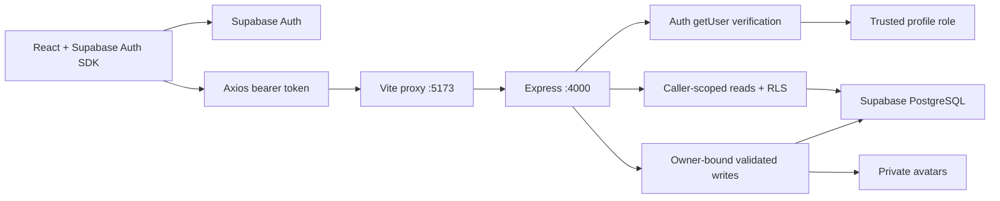

<!-- Phase 3 extension: see docs/assessment-scoring.md and development-progress.md for verified status. -->

# Architecture

## Phase 5 content architecture

The library and CMS follow the existing feature/service/repository boundaries. Shared Zod contracts validate article metadata, bounded rich-document trees, sources and query filters. React pages use owner-scoped TanStack Query and Axios; a lazy-loaded TipTap editor produces structured JSON. The backend reconstructs allowlisted content, computes reading metrics, verifies registered media, and invokes atomic SQL functions for article/tag/media-link changes and publication. Reader content is rendered as semantic React elements, never arbitrary HTML.

Supabase caller-scoped reads enforce RLS; trusted admin middleware and service-only functions protect editorial writes. Public-by-URL media is uploaded through the backend, byte-validated and re-encoded with Sharp, then referenced by controlled paths. Reference locking prevents used images from being deleted. The admin overview aggregates only content counts, with no Phase 6 reporting. See [Phase 5 guide](phase5-library.md) for lifecycle, search, conflict semantics, setup and actual live verification. Its current hosted status supersedes earlier historical setup limitations below.

## Phase 4 implementation

The current wellness architecture is described in [Phase 4 wellness](phase4-wellness.md). Feature pages use owner-scoped TanStack Query/Axios; Zustand holds the timestamp-based client timer, restored paused in sessionStorage. Express wellness routes delegate to services for progress, local-date/streak rules and reminder generation, and repositories for owner-scoped reads and transactional server writes. Database snapshots preserve completed sessions and checklist history. Shared Zod schemas validate mutation allowlists. Phase 3 condition validation accepts persisted metadata while keeping request schemas strict. Existing authentication, layouts, scoring, and recommendation services are reused.

The workspace coordinator ticks timers across navigation and polls visible-app reminders. PostgreSQL deduplication arbitrates reminder delivery across tabs. Both global delivery preference and individual schedules are respected; closed-browser delivery is not promised. See [API](api.md#phase-4-implemented-endpoints), [database](database.md#phase-4-implemented-schema), and [verification](development-progress.md).

The earlier sections below record Phase 2 and provisional plans; implemented Phase 3/4 sections supersede their statements about future modules or Zustand holding UI state only.

The existing pnpm/Turborepo monorepo contains separate React/Vite and Express applications plus shared types/schemas/configuration. Phase 2 extends it; no Git initialization, project recreation or Phase 3 assessment functionality occurred.

## Frontend identity and data

Supabase Auth owns signup, login, email confirmation, recovery, token refresh and local-scope logout. `lib/supabase.ts` uses PKCE and sessionStorage, not localStorage for tokens. Sessions persist across tab refreshes; closing the tab ends browser-side persistence. No custom JWT or remember-me feature exists. `AuthProvider` subscribes to SDK events, clears account Query caches on identity changes, restores the profile/preferences from Express, and shows explicit loading/error states. Asynchronous SDK/API work is deferred outside auth callbacks to avoid SDK lock deadlocks.

Axios attaches the current SDK access token as Bearer. TanStack Query keys include user IDs. Feature mutations invalidate account data and refresh the context profile. Zustand only holds theme/sidebar UI state. Theme supports light, dark and system with media-query changes; settings and authenticated header changes persist via the preferences API.

ProtectedRoute requires a session and loaded profile. PublicOnlyRoute handles signed-in users, OnboardingGuard requires completed onboarding, and AdminRoute checks the loaded role for navigation only. The Express backend is the actual authorization boundary. Safe intended destinations are limited to local application paths. Recovery is handled separately from ordinary private navigation.

Auth forms use React Hook Form and shared Zod rules. Onboarding saves step drafts with profile/preference APIs, then completes all values atomically through a backend transaction. Settings use live profile/preferences/goal/avatar services with explicit save/cancel and error feedback. The existing responsive shadcn layouts display actual name/email/avatar and logout. Future domain routes remain Phase 3+ placeholders.

## Backend boundaries

`authenticate` extracts Bearer, calls Supabase Auth `getUser(token)`, requires confirmed email, and attaches verified identity plus a request-scoped client. `authorize('ADMIN')` reads the trusted database role, never user metadata or request body. User routes follow router -> controller (strict shared Zod) -> service (business/image logic) -> repository (database operations).

Reads use the caller's token and RLS, plus explicit owner filters. Writes use the server-only elevated client and owner IDs derived exclusively from verified identity. Privileged functions are executable only by service_role. There are no general-purpose table/role-update endpoints. Supabase errors are mapped to safe application errors; secrets and auth headers are not logged. CORS allows the configured frontend origin. Limits are 300 requests/minute per IP across API, 120/minute on user APIs, and 10 avatar uploads/minute per verified user. The in-memory limiter is suitable for one local instance; production scaling requires a shared limiter store and explicit trusted-proxy configuration. Auth endpoints are hosted by Supabase and use its provider-side rate limits.

Avatar upload accepts one multipart image, maximum 2 MB. Multer limits file count/body parts; Sharp decodes only PNG/JPEG/WebP, limits pixels to 16,777,216, strips metadata and re-encodes to at most 512x512 WebP. Storage uses a private bucket with verified-user UUID prefixes and random filenames. The profile stores a controlled object path in avatar_url; the API returns a one-hour signed URL. Failed profile writes remove the new object; superseded objects are removed best-effort.

## Data flow

## Shared configuration and development

Shared ESM exports include strict profile/preferences/onboarding schemas, uppercase USER/ADMIN role values, response types, goal keys and validation. Root dev/build compiles shared code first. Shared source edits during dev require a shared rebuild or dev restart. Turbo accounts for frontend env variables in build caching and passes backend env variables to dev tasks. App env files live in their respective app folders.

Local checks include TypeScript, ESLint, builds, schema tests, migration/RLS tests using PGlite, and credential-free Playwright tests. PGlite supplies a local PostgreSQL engine with test-only Auth/Storage relation scaffolding; it does not verify Supabase email, Auth tokens, hosted database or actual Storage. See [setup](supabase-setup.md) for external configuration and live acceptance checks. No live connection is claimed.

Database/RLS details: [database.md](database.md). Actual and future APIs: [api.md](api.md). Phase status: [development-progress.md](development-progress.md).

## Phase 3 extension

Assessment routes delegate to version-aware services/repositories. Server-only RPCs atomically save attempts/responses/results/recommendations and publish immutable versions. Frontend uses typed Axios and Query hooks. Rules are bounded JSON conditions, never executable code. Result snapshots preserve metadata, questions, scoring and recommendation explanations. Trend groups use computed definition fingerprints; optional answer sets are separated.

## Phase 6: integrated application architecture

The authenticated dashboard, `/progress` and `/admin/analytics` now use real backend reporting DTOs rather than foundation placeholders. The pages are lazy-loaded; shared Recharts components provide compatible assessment trends, activity bars/distribution, accessible data summaries and empty/error/loading states. A lazy jsPDF generator exports the authenticated selected-range report with an embedded licensed font and multipage disclaimers.

`apps/api/src/modules/analytics` follows the routes/controller/service/repository split. Shared contracts and Zod validation live in `packages/shared/src/schemas/analytics.ts`. PostgreSQL RPCs aggregate counts/distributions, compatible series, pagination and per-goal daily counts. The service reuses Phase 4 goal/streak calculations, avoiding raw lifetime-session transfer to the new dashboard. Auth middleware binds owner IDs; ADMIN middleware and a database role check guard admin aggregates. Functions remain service-only with invoker privileges and fixed search paths.

TanStack Query keys are centralized in `services/api.ts` and include identity and filters. Assessment/recommendation/activity/goal/profile mutations invalidate affected dashboard/progress data. Library content changes refresh admin inventory. Notification read actions retain bell/history synchronization without analytics refetches. Recommendations link active activities and library searches; archived definitions keep historical snapshots. Existing session restoration/onboarding/admin redirects remain authoritative.

See [Phase 6 implementation and reporting semantics](phase6-analytics.md) for date/streak/privacy rules, migration dependencies and hosted limitations. Phase 7/8 work has not started.
