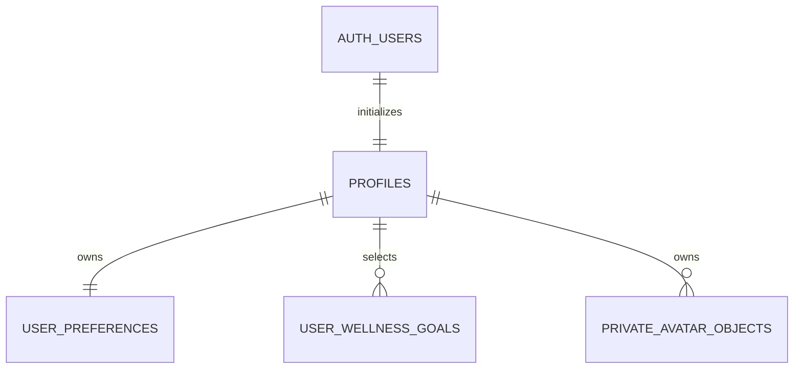
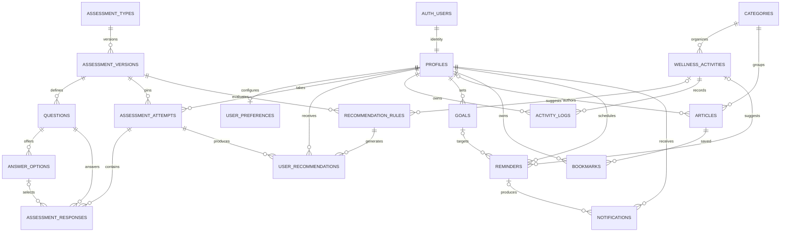

<!-- Phase 3 extension: see docs/assessment-scoring.md and development-progress.md for verified status. -->

# Database architecture

## Phase 5 implemented schema

`202610180006_phase5_library.sql` adds seven tables: `article_categories`, `articles`, `article_tags`, `article_tag_links`, `bookmarks`, `article_media`, and `article_media_links`. It adds a generated title/summary full-text vector and GIN index, stable list/FK indexes, unique slugs/bookmarks, revision/update triggers, checks, RLS, owner bookmark mutations, trusted admin draft reads, service-only editorial writes, and transactional article/publication/media reservation functions. Sources are a validated JSON array on `articles`. Media paths reference registered Storage metadata; covers and inline images retain explicit reference links.

`202610180007_phase5_conflicts.sql` is an additive patch for the installed library functions. It replaces business-conflict SQLSTATE `40001` with explicit `PT409`, preserving definitions and privileges, and exposes a service-only readiness marker. No table is dropped or reset. The Phase 5 schema and public `article-media` bucket are present in the observed hosted project, but the `007` marker and Phase 4 `archived_at` column remain absent. Apply only pending files after reviewing migration history; [exact order and commands](phase5-library.md#current-hosted-state-and-safe-migration-order) are documented.

The twelve-article seed was applied through the optional server-side REST seeder and repeated with no duplicate inserts. Live CMS, Storage and two-user bookmark RLS checks passed with temporary resources removed. The canonical SQL seed remains the preferred transactional setup path. Historical Phase 1 designs and earlier missing-table notes below do not describe the current schema state.

## Phase 4 implemented schema

The integrity migration records `wellness_goals.archived_at` with a trigger that preserves it across archive retries, so later completed sessions cannot change archived history.

`202610160004_phase4_wellness.sql` adds `wellness_activities`, `activity_sessions`, `wellness_goals`, `goal_activity_links`, `reminder_settings`, `notifications`, and `daily_wellness_checklists`. It extends `user_preferences.timezone` and `recommendation_rules.activity_id`, preserving existing onboarding interests. `202610180005_phase4_integrity.sql` adds an active-activity category/duration index and history-array constraints, enforces minimum server elapsed time for timer completions, and preserves rule revisions when only the linked activity changes.

All private tables have owner-select RLS; authenticated clients have no direct write grants. Service-only functions create idempotent sessions, lock completion/cancellation, atomically update goals/links/history, generate deduplicated notifications, and save today's checklist snapshot once. Activities are active-readable for authenticated users and admin-written through authorized backend routes. UTC timestamps, local-day/streak rules, constraints, seed ordering, and setup commands are documented in [Phase 4 wellness](phase4-wellness.md).

The original entity design below is historical. Phase 4 uses `activity_sessions`, `wellness_goals`, and `reminder_settings` instead of duplicating provisional `activity_logs`, `goals`, or `reminders`. No health-library tables are introduced. Hosted installation is pending; local SQL results are in the progress log.

## Phase 2 implemented schema (authoritative)

Two versioned migrations now implement Phase 2. They have been executed only against the isolated PGlite test database, not a live Supabase project. Apply them using [Supabase setup](supabase-setup.md).

| Table               | Key and fields                                                                                                                                                                        | Integrity / ownership                                                                                                                                                                                                  |
| ------------------- | ------------------------------------------------------------------------------------------------------------------------------------------------------------------------------------- | ---------------------------------------------------------------------------------------------------------------------------------------------------------------------------------------------------------------------- |
| profiles            | id UUID PK/FK auth.users; full_name; email; role USER/ADMIN; avatar_url nullable; occupation nullable; onboarding_completed; created_at/updated_at                                    | Auth deletion cascades. Trigger always creates USER, ignoring metadata roles. Email is an Auth-synchronized copy. Browser roles have SELECT only. avatar_url stores an owned Storage path, not a permanent public URL. |
| user_preferences    | id UUID PK; user_id UNIQUE FK profiles; age_range; primary_device; daily_screen_hours; usage_purpose; sleep_time/wake_time; break_frequency; theme; notifications_enabled; timestamps | Owner cascade; CHECK constraints enforce enumerated values, 0-24 hours and valid theme. Optional fields allow NULL. Unique user_id supplies owner index.                                                               |
| user_wellness_goals | id UUID PK; user_id FK profiles; goal_key; created_at                                                                                                                                 | Unique(user_id,goal_key), allowlisted goal keys, owner cascade. Selected interests only, not goal tracking.                                                                                                            |

Every public Phase 2 table enables RLS and default-deny anonymous access. Authenticated owners can SELECT only their own rows via auth.uid(). Direct browser mutations are denied by both lack of grants and lack of policies. This deliberately uses a stricter model than client-write RLS: all writes go through Express with verified identity, strict allowed fields and explicit owner filters. Server/service-role access bypasses RLS, so these backend checks remain mandatory. Admin profile roles do not grant broad access to other users' private data.

SECURITY DEFINER functions use an empty search_path and fully qualified tables. Trigger functions have public execution revoked. complete_onboarding and replace_wellness_goals are callable only by service_role. Onboarding locks the profile row, updates profile/preferences, replaces unique goals, and marks completion in one transaction; errors roll everything back. Repeated submissions are safe and concurrent saves for the same user serialize. Step drafts use ordinary owner-scoped profile/preference updates, without setting completion.

The private avatars bucket has a 2 MB limit, WebP MIME allowlist, and owner SELECT policy. Client uploads/deletes are denied. Express validates, decodes, resizes and re-encodes uploads before service-role Storage writes. Random user-prefixed paths are stored in profiles and converted into one-hour signed URLs on API reads. Auth account deletion cascades relational data, but Storage object cleanup must be handled by a future administrative account-deletion workflow.

Local tests verify initialization, metadata-role rejection, owner isolation, forbidden direct writes/RPCs, constraints, idempotent submission, transactional rollback, email synchronization, cascades and Storage owner-read policy logic. Actual hosted Auth/Storage/RLS integration remains unverified.

Initial administrator provisioning is a trusted SQL-editor update to a verified UUID/email, documented in [setup](supabase-setup.md). No public API can change roles.

## Phase 1 full-application design reference

The following is retained planning for later modules, not executed schema. The Phase 2 definitions above supersede its old profiles/preferences fields, lowercase roles and client-write suggestions. In particular, full_name replaces display_name, email is synchronized from Auth, preferences have their own UUID key, and the new onboarding-interest table is distinct from future progress-tracking goals.

## Conventions and ownership

Unless specified otherwise, `id uuid` is the primary key with `gen_random_uuid()` default; timestamps are `timestamptz` in UTC. Every table has `created_at`; mutable rows also have `updated_at`, maintained by a trigger. Business dates use the owner's IANA timezone from preferences. User-owned records have a required `user_id` referencing `profiles.id`. UUIDs are identifiers, not access controls. Foreign keys are indexed. Required fields below are NOT NULL; `?` marks nullable fields.

| Entity               | Fields and constraints                                                                                                                                                                               | Ownership / deletion                                                                                                                                                                                                                               |
| -------------------- | ---------------------------------------------------------------------------------------------------------------------------------------------------------------------------------------------------- | -------------------------------------------------------------------------------------------------------------------------------------------------------------------------------------------------------------------------------------------------- |
| profiles             | `id` PK/FK → auth.users.id; `display_name text`; `role user_role DEFAULT 'user'` (user/admin); `avatar_path text?`                                                                                   | User; identity deletion cascades. Role can only be changed by privileged administrative code. Do not duplicate email from Auth.                                                                                                                    |
| user_preferences     | `user_id` PK/FK → profiles.id; `timezone text DEFAULT 'Asia/Kolkata'`; `theme text CHECK IN ('system','light','dark')`; `reminders_enabled bool DEFAULT false`                                       | Owner; cascade on profile deletion.                                                                                                                                                                                                                |
| categories           | `id`; `slug text UNIQUE`; `name text`; `description text?`                                                                                                                                           | Admin-managed reference content; referenced categories restrict deletion.                                                                                                                                                                          |
| assessment_types     | `id`; `slug text UNIQUE`; `name text`; `category assessment_category`; `description text`; `archived_at timestamptz?`                                                                                | Admin-managed; categories: screen_habits, sleep, physical, mental. Restrict deletion if versions exist.                                                                                                                                            |
| assessment_versions  | `id`; `assessment_type_id` FK; `version int CHECK > 0`; `status` draft/published/retired; `scoring_config jsonb`; `published_at timestamptz?`; UNIQUE(type_id, version)                              | Admin-managed. Restrict deletion once referenced. Partial unique index permits one published version per type.                                                                                                                                     |
| questions            | `id`; `version_id` FK; `position int CHECK > 0`; `prompt text`; `response_kind` single_choice/number/text; `required bool`; `validation jsonb`; UNIQUE(version_id, position); UNIQUE(id, version_id) | Owned by version. Published content immutable. Cascade only for deletable draft versions.                                                                                                                                                          |
| answer_options       | `id`; `question_id` FK; `position int CHECK > 0`; `label text`; `score numeric`; UNIQUE(question_id, position); UNIQUE(id, question_id)                                                              | Owned by question; same publication protections.                                                                                                                                                                                                   |
| assessment_attempts  | `id`; `user_id` FK; `version_id` FK; `status` in_progress/submitted; `started_at`; `submitted_at?`; `score numeric?`; `result_snapshot jsonb?`; UNIQUE(id, version_id); UNIQUE(id, user_id)          | Owner; cascade on profile deletion; referenced versions restrict deletion. Server computes immutable submitted result.                                                                                                                             |
| assessment_responses | `id`; `attempt_id`; `version_id`; `question_id`; `option_id?`; `numeric_value numeric?`; `text_value text?`; UNIQUE(attempt_id, question_id)                                                         | Inherited from attempt; cascade with attempt. Composite FK(attempt_id,version_id) → attempts, FK(question_id,version_id) → questions, FK(option_id,question_id) → options. Exactly one value; server validates response_kind and required answers. |
| recommendation_rules | `id`; `version_id` FK; `rule_key text`; `revision int > 0`; `criteria jsonb`; `title text`; `body text`; `activity_id?` FK; `active bool`; UNIQUE(version_id,rule_key,revision)                      | Admin-managed, immutable published revisions; restrict deletion if used. Criteria validated against a versioned Zod schema before publication.                                                                                                     |
| user_recommendations | `id`; `user_id` FK; `attempt_id`; `rule_id` FK; `content_snapshot jsonb`; `status` new/saved/dismissed/completed; UNIQUE(attempt_id,rule_id)                                                         | Owner; composite FK(attempt_id,user_id) → attempts prevents cross-user links. Profile/attempt deletion cascades. Snapshot preserves historical content.                                                                                            |
| wellness_activities  | `id`; `category_id` FK; `slug text UNIQUE`; `title text`; `instructions text`; `duration_seconds int CHECK > 0`; `status` draft/published/archived                                                   | Admin-managed; archive rather than delete if referenced.                                                                                                                                                                                           |
| activity_logs        | `id`; `user_id` FK; `activity_id` FK; `completed_at`; `duration_seconds int CHECK >= 0`; `notes text?`                                                                                               | Owner; profile cascade, activity restrict.                                                                                                                                                                                                         |
| goals                | `id`; `user_id` FK; `title text`; `metric` activity_count/screen_minutes; `target numeric CHECK > 0`; `start_date date`; `end_date date CHECK >= start_date`; `status` active/completed/archived     | Owner; profile cascade. Progress derived from authorized records; screen-time collection remains a future design decision.                                                                                                                         |
| articles             | `id`; `category_id` FK; `author_id?` FK → profiles; `slug text UNIQUE`; `title text`; `summary text`; `body text`; `cover_path text?`; `status` draft/published/archived; `published_at?`            | Admin-managed, author SET NULL on account deletion. Render sanitized content.                                                                                                                                                                      |
| bookmarks            | `user_id` FK; `article_id` FK; composite PK(user_id,article_id); `created_at`                                                                                                                        | Owner; cascade from owner or article. No redundant UUID needed.                                                                                                                                                                                    |
| reminders            | `id`; `user_id` FK; `goal_id?`; `activity_id?` FK; `label text`; `schedule jsonb`; `timezone text`; `next_run_at?`; `enabled bool`                                                                   | Owner; FK(goal_id,user_id) → goals(id,user_id), requiring UNIQUE(id,user_id) on goals. Goal cascade; activity restrict. Validate recurrence/timezone server-side.                                                                                  |
| notifications        | `id`; `user_id` FK; `reminder_id?` FK; `kind text`; `title text`; `body text`; `read_at?`; `dedupe_key text?`; UNIQUE(user_id,dedupe_key)                                                            | Owner; server inserts; reminder SET NULL. Owner can mark read only. Profile cascade.                                                                                                                                                               |

## Relationships

## Assessment versioning and consistency

Publishing is transactional: validate question ordering, answer types, scoring bounds, and rules; retire the previous version and publish the new one atomically. Published versions, questions, options, scoring configurations, and rule revisions are immutable (enforced with database triggers/privileges, not only UI). Editing creates a new draft. Attempts pin one version at creation and remain on it even after retirement. Submitted attempts/responses cannot be edited. Submission locks the attempt, verifies required answers and version membership, computes results server-side, writes result/recommendation snapshots and submission status in one transaction. Repeated submission returns the existing result without duplicate recommendations. No scoring or diagnosis logic exists in Phase 1.

## Index plan

- Index every FK (unless already the leading columns of an index), especially version/question/attempt lookups and content category filters.
- `assessment_attempts(user_id, started_at DESC, id)`, `activity_logs(user_id, completed_at DESC, id)`, `goals(user_id,status)`, `user_recommendations(user_id,status,created_at DESC)` support owner-scoped lists.
- `notifications(user_id,created_at DESC)` plus a partial unread index `WHERE read_at IS NULL`.
- `reminders(next_run_at) WHERE enabled = true` supports the future scheduler.
- Partial indexes on published article date and activity category; unique slugs support detail routes. Article text search can use a generated tsvector with GIN once search is implemented.
- Avoid indexing sensitive free text or all JSONB fields by default; use query measurements before adding specialized indexes.

## Row-level security and roles (required before integration)

Enable RLS on every public table with default deny. `anon` can read only published public articles, categories, and activities if public content access is deliberately enabled; no personal rows. Authenticated users read published assessment definitions/options; drafts and recommendation rules are admin-only. Owners use `auth.uid() = user_id` in both USING and WITH CHECK for permitted CRUD; profiles use `auth.uid() = id`. Responses use an EXISTS lookup of the owning attempt, with mutation limited to in-progress attempts. User recommendations are server-generated and owner-readable; updates are limited to status. Notifications are server-generated and updates limited to read_at. Use column privileges or narrow RPCs to prevent protected-field changes: RLS alone is not column security.

Users must never set profile.role, attempt.score, submitted result snapshots, recommendation contents, or notification bodies. Derive admin authority from a server-managed role/claim or a narrowly scoped SECURITY DEFINER helper with a fixed search_path, avoiding recursive profile policies. Never trust editable Supabase user_metadata. Admin content write policies require that authority; broad admin access to personal wellness data is not a default. Future analytics should expose aggregated/minimized data with explicit authorization.

Use caller-scoped Supabase access where possible so RLS applies. Service-role credentials bypass RLS and stay server-only; privileged operations must perform explicit ownership and role checks. Test RLS with anonymous, owner, other-user, and admin sessions before release. Define deletion/export and retention policy before collecting sensitive wellness data. Account deletion removes personal records, while authored public content retains no author identity.

## Storage preparation

Planned buckets: private `avatars` with owner-prefixed paths (`user_id/object_id`), and admin-written article images. Validate MIME type and size server-side; use signed URLs for private objects. Storage object RLS checks the path owner and appropriate admin claims. Database references store paths rather than expiring signed URLs. A later account-deletion workflow must remove owned Storage objects as well as database rows. No buckets, credentials, migrations, or seed data are provisioned now.

## Phase 3 implemented migration

202610160003_phase3_assessments.sql creates assessment_types, assessment_versions, assessment_questions, assessment_options, assessment_attempts, assessment_responses, recommendation_rules and user_recommendations. Composite FKs enforce version/question/option and attempt-owner consistency. Owner RLS hides private rows; definitions expose only published content. Authenticated clients cannot read scoring configuration/option scores or rules directly, or write these tables. Trusted Express services perform validated writes. Four server-only functions manage draft creation/save, publication and atomic submission. Version/answer history is immutable. Unique owner/idempotency keys plus payload hashes prevent duplicate submissions; unique owner/rule/revision rows preserve recommendation status across retakes. Seed-phase3.sql is idempotent by assessment slug and does not overwrite existing administrator edits.

## Phase 6 aggregation migration

`202610260008_phase6_analytics.sql` depends on installed migrations `001`–`007`; specifically `005` supplies `wellness_goals.archived_at`. It adds completed-session date/owner, assessment date/owner and profile creation indexes, reusing existing owner/date and goal-link indexes. It creates personal/dashboard/admin aggregate RPCs and a small-group suppression helper, with no summary tables or data rewrites.

All four functions have empty search paths, use invoker privileges and revoke EXECUTE from PUBLIC, anon and authenticated; only service_role can call them. The API supplies the verified owner; the admin RPC also verifies the caller's trusted ADMIN profile. Existing RLS and idempotency constraints are unchanged. No questionnaire responses or result snapshots enter analytics DTOs. Session activity snapshots preserve counts/categories after archiving.

Date bounds use separate local-midnight conversions to timestamptz, preserving DST. Personal SQL performs count/group aggregation, zero-filled days, paginated timeline/history and per-goal daily counts. Phase 4 code consumes aggregated counts for exact goal/streak parity. Assessment groups include assessment ID plus compatibility fingerprint. Admin nonempty buckets require five distinct contributors; hidden breakdowns suppress their behavioral overview totals too.

The 2026-10-26 hosted read-only check found `007` installed, `005` missing and new `008` absent. No direct database URL is configured and no hosted SQL was executed. For this project, review/apply pending `005`, retain installed `006`/`007`, then apply `008` once. Do not rerun historical create-table migrations. Use `pnpm db:check-content` and `pnpm db:check-analytics` to check readiness. Fresh installs apply `001`–`008` once in order; seeds are separate. Exact instructions: [Phase 6 guide](phase6-analytics.md).
